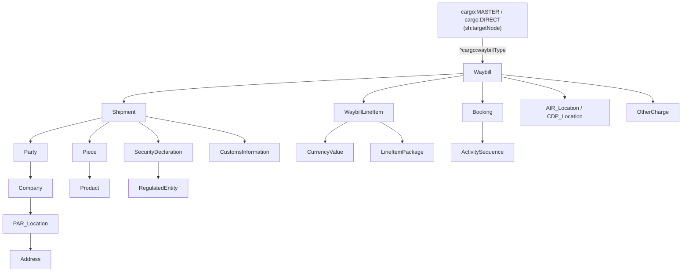

# SHACL Validation: Concepts

## Introduction

The Data Orchestration provides [SHACL](https://www.w3.org/TR/shacl/) shapes that describe what a ONE Record data set must look like to carry the same information as a Cargo-XML message. With these shapes, any ONE Record implementer can check their data against the same rules, using any standard SHACL engine.

This section has three pages:

- **Concepts** (this page): what SHACL is, how the shapes are built and how to read the results.
- [Shapes and mappings](./shacl-shapes.md): the available shape files and the messages they cover.
- [Validating with SHACL Play](./shacl-play.md): a step-by-step guide using a free online tool.

!!! info "Based on Cargo-XML, not on Resolution 600a"
    For now, the shapes are **not** derived directly from IATA Resolution 600a (the Air Waybill requirements). They are derived from the [Cargo-XML mappings](./orchestration-cxml.md) (XFWB, XFZB, XFHL). The Cargo-XML messages follow Resolution 600a but cover more data elements and business rules. A data set that passes the shapes therefore holds everything needed to build the matching Cargo-XML message.

## What is SHACL?

The **Shapes Constraint Language (SHACL)** is a W3C Recommendation for validating RDF graphs. ONE Record data is RDF (usually serialized as JSON-LD), so SHACL is the natural way to validate it.

A SHACL file (a *shapes graph*) holds constraints such as:

- `cargo:Waybill` must have exactly one `cargo:waybillNumber`,
- `cargo:securityStatus` must be one of `NSC`, `SCO`, `SHR`, `SPX`,
- a `cargo:Value` needs a `numericalValue` of type `xsd:double` and a `unit`.

A SHACL engine checks a *data graph* against the shapes graph and returns a **validation report**. Each result in the report names the focus node (the object that failed), the property path, the failing value, the constraint and a severity.

### Why SHACL for ONE Record?

- **Standard**: one machine-readable rule set instead of each implementer writing and maintaining their own checks.
- **Tool agnostic**: the same file works in any compliant engine, in a CI pipeline, a server or an online tool.
- **Traceable**: each constraint comes from a field in the Cargo-XML mapping, so a failure points to a concrete data element.
- **Versioned**: shapes are released together with the data model (for example `2026-07`).

## SHACL version and features used

The shapes use **SHACL 1.0 Core** only ([W3C Recommendation, 2017](https://www.w3.org/TR/shacl/)). They do not use SHACL-SPARQL, SHACL Advanced Features (rules, functions) or SHACL 1.2 drafts. Any engine that supports SHACL Core can run them, for example [pySHACL](https://github.com/RDFLib/pySHACL), [Apache Jena](https://jena.apache.org/documentation/shacl/), [TopBraid SHACL](https://github.com/TopQuadrant/shacl), [RDF4J](https://rdf4j.org/documentation/programming/shacl/) or [SHACL Play](https://shacl-play.sparna.fr/play/validate).

| Feature | Used for |
| --- | --- |
| `sh:targetNode` + `sh:inversePath` | Entry point: select the waybill through its `cargo:waybillType` (`MASTER`, `DIRECT` or `HOUSE`) |
| `sh:node` | Link a node shape to the shapes of the objects it references (builds the [DAG](#structure-a-directed-acyclic-graph)) |
| `sh:minCount` / `sh:maxCount` | Mandatory fields and cardinality from the mapping |
| `sh:nodeKind sh:IRI` | Reject blank nodes ("Blank node not permitted") |
| `sh:datatype` | Literal data types, such as `xsd:double`, `xsd:dateTime`, `xsd:string` |
| `sh:pattern` | Code-list URI form (`...#CODE`) and business formats such as the regulated entity identifier |
| `sh:in`, `sh:hasValue` | Closed code lists, such as security status or charge codes |
| `sh:or`, `sh:not` | Alternatives, such as a goods description on either the Shipment or a Piece |
| `sh:qualifiedValueShape` | Role-based rules, such as exactly one shipper (SHP) and one consignee (CNE) |
| `sh:zeroOrMorePath`, `sh:oneOrMorePath` | Rules that follow nested pieces |
| `sh:severity`, `sh:message` | Flagging logic and readable messages |

## Structure: a directed acyclic graph

Each shape file starts from a single entry point and goes down through the object graph. Node shapes reference each other with `sh:node`, and no shape refers back to one of its ancestors. The shapes form a **directed acyclic graph (DAG)**: every path ends at a leaf shape (for example `Value`, `Address` or `CurrencyValue`).

*Simplified view of `air-waybill-2026-07.ttl`. The house waybill shape follows the same pattern, starting from `cargo:HOUSE`.*

Some shapes carry a prefix because the same ONE Record class is checked with different rules depending on where it is used. For example, `AIR_Location` (departure and arrival airports, needs `locationCodes`) is stricter than `CDP_Location` (carrier declaration place, needs only `locationName`).

## Flagging logic

Each constraint has a severity. The severity tells you which message the gap would break:

| Severity | Air waybill shape | House waybill shape |
| --- | --- | --- |
| **Violation** | Breaks the Cargo-IMP FWB; or ISS (security) information in `CustomsInformation` | Breaks the Cargo-IMP FHL; FHL mandatory fields; or ISS in `CustomsInformation` |
| **Warning** | Breaks the XFWB; malformed code-list URI | Breaks the XFZB; XFZB mandatory fields; malformed code-list URI |
| **Info** | Data type mismatch | Data type mismatch |

Blank nodes, values outside a closed code list and cardinality errors are also reported as Violations.

In practice:

- **Violations** must be fixed. Without these data, not even the legacy message can be produced.
- **Warnings** should be fixed to support Cargo-XML and to follow the ONE Record code-list rules.
- **Infos** point at literals with the wrong data type. Most consumers can still read them, but they should be corrected.

## Preparing data for validation

The shapes validate a **message-like payload**: the full set of linked objects that a Cargo-XML message would carry, not one Logistics Object on its own. To build it:

1. Start from the [mapping](./orchestration-cxml.md) of the message you want to cover (for example XFWB for an air waybill).
2. Collect the `Waybill` and every object it reaches: `Shipment`, `Piece`, `Party`, `Company`, `Location`, `Address`, `WaybillLineItem`, `Booking`, `TransportMovement` and so on.
3. Put all of them in **one** data graph (for example a JSON-LD document with an `@graph` array). If the objects are on a ONE Record server, retrieve and merge them first.
4. Validate the graph against the matching shape file.

Common pitfalls:

- **Blank nodes are not permitted.** Every object must have an `@id` (IRI). See the [serialization guidelines](../API-Security/implementation-guidelines.md#serialization-and-data-formats).
- **Code-list values are IRIs** of the form `{baseURL}/{codeListName}#{code}`, for example `https://onerecord.iata.org/ns/code-lists/SecurityStatus#SPX`. See [URI structure](../Data-Model/code-lists.md#uri-structure).
- **JSON numbers and `xsd:double`**: in JSON-LD, a number without a fractional part (such as `120.0` once parsed) becomes `xsd:integer`, not `xsd:double`. Write measured values as typed literals: `{"@type": "xsd:double", "@value": "120.0"}`.
- **Back-links**: some rules check both directions, for example `Piece#ofShipment` and `SecurityDeclaration#issuedForShipment`.

## Reading the results: focus on root causes

Because of how the shapes are built, **only root-cause results matter**. All other results are follow-up results of the same error.

Each property is checked with several small constraints (cardinality, node kind, nested shape, datatype). When an object deep in the graph fails any constraint, the `sh:node` check of its parent fails too, then the grandparent's, and so on up to the waybill. Per the SHACL specification, `sh:node` fails whenever the nested node has *any* result, whatever its severity. These follow-up results are always reported as **Violation** with the `sh:NodeConstraintComponent` and the message "Value does not have shape ...", even when the root cause is only a Warning or an Info.

Example with the [sample payload](./assets/shacl/sample-waybill-errors.jsonld){:download="sample-waybill-errors.jsonld"}. It holds two errors: the consignee address has no `cityName`, and the rate charge uses a malformed currency URI (`.../CurrencyCode/EUR` instead of `.../CurrencyCode#EUR`). The report holds 10 results:

| # | Severity | Focus node | Path | Constraint | Root cause? |
| --- | --- | --- | --- | --- | --- |
| 1 | Violation | `addr-cne` | `cargo:cityName` | MinCount | **Yes** |
| 2 | Violation | `loc-cne` | `cargo:address` | Node (Address) | follows from 1 |
| 3 | Violation | `co-cne` | `cargo:basedAtLocation` | Node (PAR_Location) | follows from 1 |
| 4 | Violation | `party-cne` | `cargo:partyDetails` | Node (Company) | follows from 1 |
| 5 | Violation | `shipment-1` | `cargo:involvedParties` | Node (Party) | follows from 1 |
| 6 | Violation | `awb-020-12345675` | `cargo:shipment` | Node (Shipment) | follows from 1 |
| 7 | Warning | `rate-1` | `cargo:currencyUnit` | Pattern | **Yes** |
| 8 | Violation | `wli-1` | `cargo:rateCharge` | Node (CurrencyValue) | follows from 7 |
| 9 | Violation | `awb-020-12345675` | `cargo:waybillLineItems` | Node (WaybillLineItem) | follows from 7 |
| 10 | Violation | `cargo:MASTER` | `^cargo:waybillType` | Node (Waybill) | follows from 1 and 7 |

To find the root causes:

1. Ignore all results with `sh:NodeConstraintComponent` ("Value does not have shape ...").
2. Fix the rest. Their severity is the real severity of the issue.
3. Validate again. The follow-up results disappear with their root cause.

!!! tip
    A root-cause Warning or Info still makes the whole waybill "non-conforming" through the follow-up Violations. To judge whether a payload can produce a Cargo-IMP message, look at the severity of the root causes only.
