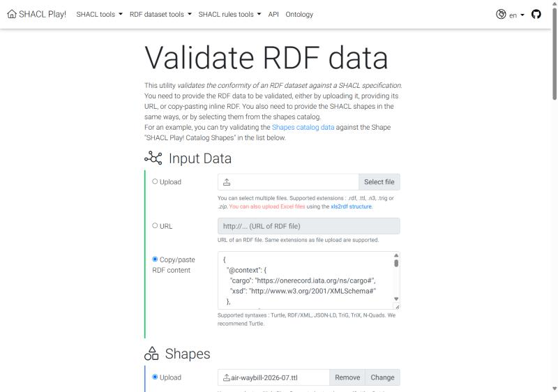
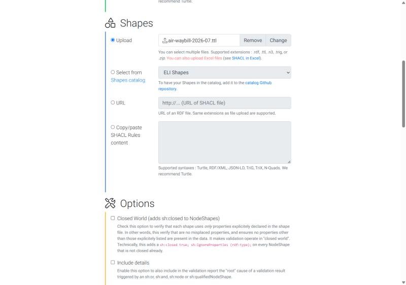
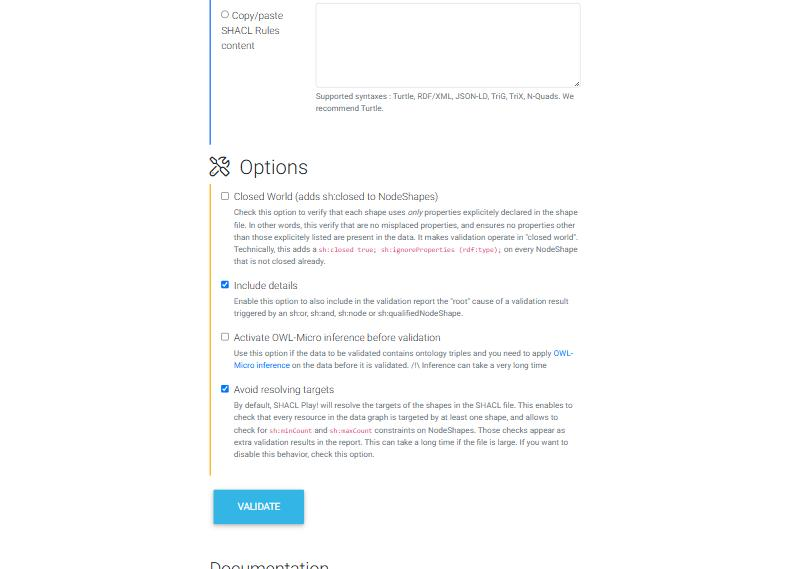
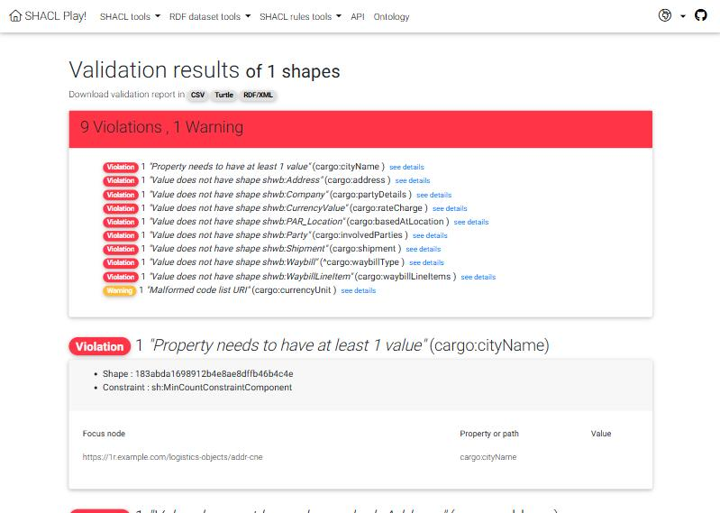
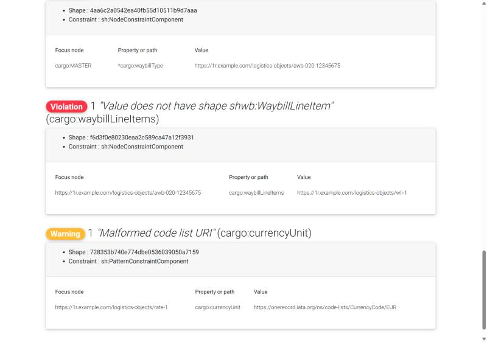

# Validating with SHACL Play

[SHACL Play](https://shacl-play.sparna.fr/play/validate) is a free online SHACL validator by Sparna. You can try the ONE Record shapes there without installing anything. This guide uses the sample payloads from [Shapes and mappings](./shacl-shapes.md#sample-payloads).

!!! warning "Public tool"
    SHACL Play is a public web service run by a third party. Only upload test or anonymised data. For production data, run the shapes in your own environment (see [Running the shapes in your own tools](./shacl-shapes.md#running-the-shapes-in-your-own-tools)).

## What you need

- A data file, for example [sample-waybill-errors.jsonld](./assets/shacl/sample-waybill-errors.jsonld){:download="sample-waybill-errors.jsonld"}.
- The matching shape file, for example [air-waybill-2026-07.ttl](./assets/shacl/air-waybill-2026-07.ttl){:download="air-waybill-2026-07.ttl"}.

## Step 1: Provide the data

Open [https://shacl-play.sparna.fr/play/validate](https://shacl-play.sparna.fr/play/validate). In **Input Data**, choose **Copy/paste RDF content** and paste the content of the JSON-LD file.



!!! note
    The **Upload** option lists only `.rdf`, `.ttl`, `.n3`, `.trig` and `.zip` files. Paste JSON-LD into the text box, or convert it to Turtle first. You can also use **URL** if the payload is published somewhere SHACL Play can reach.

## Step 2: Provide the shapes

In **Shapes**, choose **Upload** and select the shape file (`air-waybill-2026-07.ttl` for a master or direct waybill, `house-waybill-2026-07.ttl` for a house waybill).



You can also choose **URL** and give the raw GitHub link of the shape file, for example:

```text
https://raw.githubusercontent.com/IATA-Cargo/ONE-Record/master/working_draft/Data-Orchestration/SHACL-Shapes/air-waybill-2026-07.ttl
```

## Step 3: Set the options

In **Options**:

- Check **Include details**. Without it, SHACL Play reports only the top-level result (the waybill does not conform) and hides the [root causes](./shacl-concepts.md#reading-the-results-focus-on-root-causes).
- Check **Avoid resolving targets**. Otherwise SHACL Play adds its own Warnings ("Subject of a triple was not validated by any shape") for every object that is checked through `sh:node` and not through a target. These are not ONE Record findings.
- Leave **Closed World** and **OWL-Micro inference** unchecked.



Click **VALIDATE**.

## Step 4: Read the report

The summary lists the results grouped by message. For the sample with errors you get **9 Violations and 1 Warning**:



Only two of these are root causes:

- **Violation** "Property needs to have at least 1 value" on `cargo:cityName`: the consignee address has no city.
- **Warning** "Malformed code list URI" on `cargo:currencyUnit`: the currency IRI is `.../CurrencyCode/EUR` instead of `.../CurrencyCode#EUR`.

All results "Value does not have shape ..." (`sh:NodeConstraintComponent`) follow from these two and can be ignored. See [Reading the results](./shacl-concepts.md#reading-the-results-focus-on-root-causes).

Click **see details** or scroll down to find the focus node, path and value of each result:



## Step 5: Fix and validate again

Fix the root causes in your data and validate again. When you validate [sample-waybill-valid.jsonld](./assets/shacl/sample-waybill-valid.jsonld){:download="sample-waybill-valid.jsonld"}, SHACL Play reports that the data conforms.

The report can be downloaded as **CSV**, **Turtle** or **RDF/XML** from the top of the results page, for example to share it with a partner or to compare runs.

## Troubleshooting

| Symptom | Likely cause |
| --- | --- |
| Only one Violation on `cargo:MASTER` / `cargo:HOUSE` | **Include details** is not checked |
| Many Warnings "Subject of a triple was not validated by any shape" | **Avoid resolving targets** is not checked |
| No results at all, but data is incomplete | `cargo:waybillType` is missing or does not use `cargo:MASTER`, `cargo:DIRECT` or `cargo:HOUSE`, so no waybill is targeted |
| Info "Value must be a valid literal of type double" on `numericalValue` | A JSON number such as `120.0` was read as `xsd:integer`. Use `{"@type": "xsd:double", "@value": "120.0"}` |
| Many "Blank node not permitted" Violations | Embedded objects have no `@id`. Give every object an IRI |
| Parse error | Wrong syntax or extension. Paste JSON-LD into the text box instead of uploading it |
